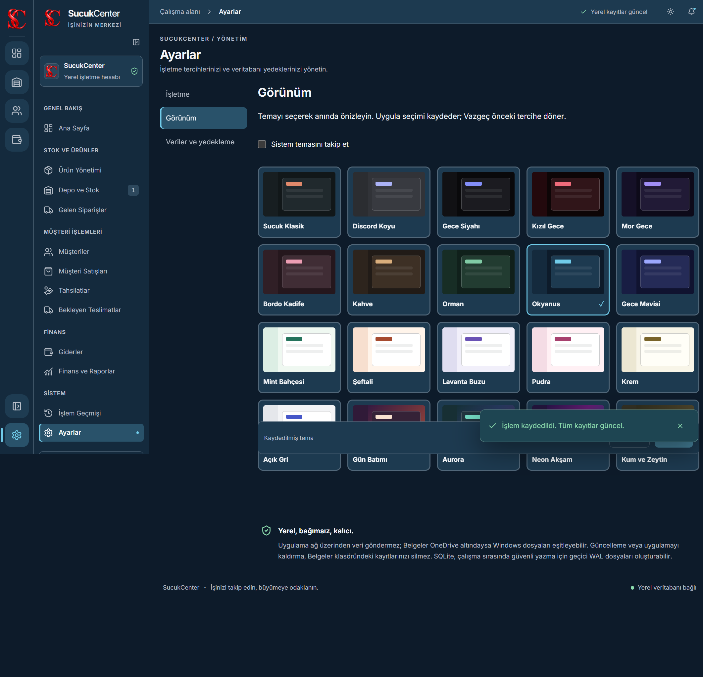
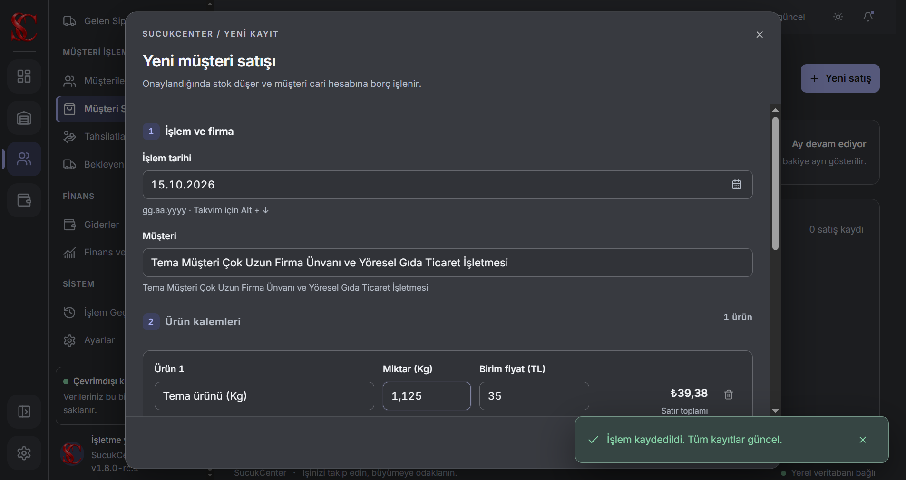
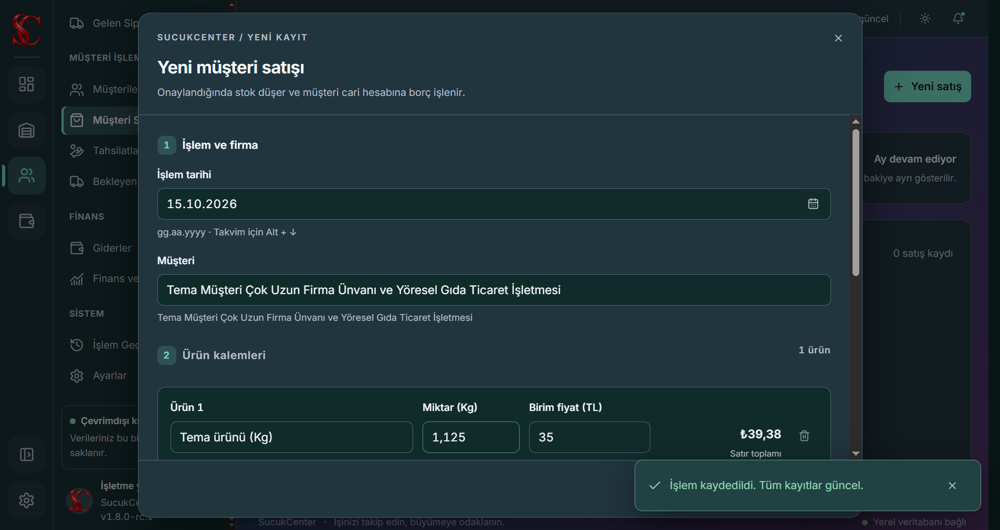

# SucukCenter 1.8.0-rc.1

[**Windows için indir — tam kurulum ve yerinde güncelleme**](https://github.com/SupremeRia/SucukCenter/releases/download/v1.8.0-rc.1/SucukCenter-1.8.0-rc.1-RiaCoding-Kurulum.exe) · [Sürüm notları](https://github.com/SupremeRia/SucukCenter/releases/tag/v1.8.0-rc.1)

**Önizleme sürümüdür.** RiaCoding imzası yerel test sertifikasıdır; güvenilir üretim imzası değildir. Windows SmartScreen uyarısı gösterebilir. Yerinde kurulum yükseltmesi, Windows 11 ve şeffaf logo üzerinde gerçek işletim sistemi tıklama geçişi henüz doğrulanmadı. Ayrıntılar: [TEST-RESULTS.md](TEST-RESULTS.md). Windows güvenlik ayarlarını değiştirmeyin.

SucukCenter; Türkçe, çevrimdışı çalışan Windows x64 işletme yönetim uygulamasıdır. Electron, React, TypeScript ve SQLite kullanır. Kullanıcının Node.js veya veritabanı sunucusu kurması gerekmez.

## Özellikler

- Ürün, tedarikçi, müşteri, depo ve stok hareketleri.
- Alış, satış, tahsilat, işletme gideri ve cari hesaplar.
- Fazla tahsilatta müşteri avansı; satış/kasa oluşturmadan cari borç ve alacak ekleme.
- Sabit fiyatlı ön ödemeli sipariş, ödeme tahsisi, ürün borcu ve kısmi teslimat.
- Geçmiş tarihli işlem, ağırlıklı ortalama maliyet ve onaylı maliyet revizyonu.
- Aylık müşteri ekstresi, dönem/yıllık rapor, ayrı brüt satış kârı ve net işletme sonucu.
- Gerekçeli düzeltme, iptal/iade, sağ tık/üç nokta menüleri ve kart arşivleme.
- Doğrulanmış SQLite yedekleme, onaylı geri yükleme ve geri dönüş yedeği.
- İki katmanlı kompakt navigasyon; 20 tema, sistem teması, önizle/uygula/vazgeç.
- Sağlanan SC program ikonu; gerçek alfa kanallı, en az yedi saniye bekleyen açılış logosu.

## Görünüm

Ekran görüntüleri yalnız sentetik kayıtlarla hazırlanmıştır.



| Discord Koyu | Aurora |
|---|---|
|  |  |

[Açılış ekranının kısa Electron kaydı](docs/media/splash.webm). Video sayfa içeriğinin kaydıdır; başka pencereye gerçek fare geçişinin kanıtı değildir.

## Kurulum ve veri

Windows 10/11 x64 hedeflenir; bu sürümün yerel test ortamı Windows 10.0.19045’tir. Windows 11 doğrulanmadı. Kurulum EXE’si hem yeni kurulum hem mevcut kurulumu kaldırmadan güncelleme içindir. Kaynak ZIP’i çalıştırılabilir uygulama değildir.

Veritabanı işletim sisteminin gerçek Belgeler klasörü altındaki **SucukCenter/sucukcenter.db** dosyasında tutulur. Yol Electron’un işletim sistemi API’sinden alınır; OneDrive yönlendirmesi korunur. Projeye, GitHub’a veya uzak bir sunucuya işletme verisi gönderilmez. OneDrive kullanılıyorsa Windows dosyaları eşitleyebilir; aynı işletme dosyasını iki bilgisayarda aynı anda açmayın.

[Güvenli kurulum](INSTALL.md) · [Güncelleme ve geri dönüş](UPDATE.md) · [Kullanım kılavuzu](USER-GUIDE.md)

## Kaynaktan geliştirme

Windows x64, Node 24.x ve npm 11.16.0+ gerekir. Bağımlılıkları ilk indirme ve paketleme internet gerektirir; kurulu uygulama temel işlevlerde internetsiz çalışır.

```powershell
npm ci
npx playwright install ffmpeg
npm run lint
npm test
npm run build
npm run test:appearance-ui
npm run test:startup-ui
npm run dev
```

Geliştirme ve test komutları ayrı, sentetik veri klasörleri kullanır; gerçek işletme dosyasına örnek kayıt eklemez. [Tam derleme/test/paketleme adımları](BUILD.md).

## Güvenlik ve yayın

Renderer dosya sistemine/veritabanına doğrudan erişmez; sınırlı preload/IPC, doğrulama, context isolation, kapalı Node integration ve çevrimdışı CSP kullanılır. Para tam sayı kuruş, miktar binde birimdir. Stok/cari/kasa/aktivite ve işlem anahtarı birlikte transaction içindedir. Mali geçmiş doğrudan silinmez. WAL/checkpoint ve doğrulanmış backup korunur. [Güvenlik](SECURITY.md).

Üretim imzalama altyapısı hazırdır; güvenilir sertifika veya hizmet erişimi ayrıca gerekir. Test sertifikası üretim modunda reddedilir. SmartScreen, Smart App Control ve Defender tespiti aynı şey değildir; geçerli imza bile her bilgisayarda uyarısız çalışma garantisi vermez.

Kaynaklar public olarak yayınlanmıştır. Proje için bir açık kaynak lisansı seçilmemiştir; public görünürlük sınırsız yeniden kullanım izni anlamına gelmez. Mevcut üçüncü taraf lisansları korunur: [THIRD_PARTY_NOTICES.md](THIRD_PARTY_NOTICES.md).

[Değişiklikler](CHANGELOG.md) · [Test sonuçları ve sınırlar](TEST-RESULTS.md) · [Katkı](CONTRIBUTING.md)
