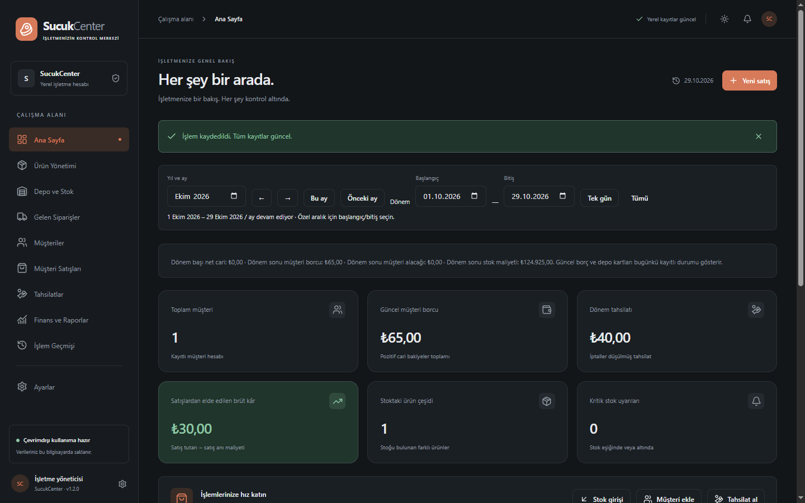
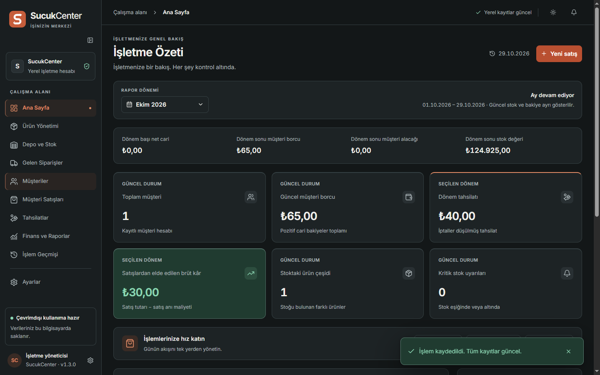

> Tarihsel sürüm kaydıdır. Güncel arayüz, paket ve test sınırları için kökteki README.md ve TEST-RESULTS.md dosyalarını kullanın.

# SucukCenter 1.3.0 — arayüz yenileme ve doğrulama

29.10.2026 · Windows 10 x64 · Electron 45.1.0 · SQLite şema v5

Kullanıcının gösterdiği klasörde 19 PNG içinde bir tekrar bulundu; 18 farklı ekran incelendi. Referanslardaki müşteri ve finans bilgileri kod, test verisi veya teslim görsellerine kopyalanmadı. Aşağıdaki görüntüler gerçek Electron uygulamasında yalnız sentetik verilerle üretildi. Gerçek işletme veritabanı açılmadı; kurulu uygulamaya güncelleme veya veri geçişi yapılmadı.

## Değişen ekranlar

- **Ortak iskelet:** Antrasit/kiremit ve açık tema, yerel Inter, tabular rakamlar, okunur başlık/metin ölçeği, ortak tasarım değişkenleri, daraltılabilir menü, gerçek SVG marka. Kısa başarılar 8 saniyelik kapanabilir canlı bildirimdir; odak/fareyle etkileşimde duraklar. İşlem gerektiren hatalar kalıcıdır.
- **İşletme Özeti:** Güncel müşteri/stok/bakiye ile seçilen dönemin tahsilat/kâr kartları etiketlerle ayrılır. Dönem sınırı bakiyeleri dört düzenli hücrede gösterilir. Kart boyutları dengelendi, hızlı işlemler korundu.
- **Ürün/stok/alış/müşteri/satış/tahsilat listeleri:** Ortak arama/araç çubuğu, doğru toplam kayıt sayısı ve mevcut sayfalama. Tablo başlıkları sabit; metinler sola, miktar/tutarlar sağa hizalı. Hover/klavye odağı belirgin. Boş liste, arama sonucu yok, yükleniyor ve hata farklı görünümlerdir.
- **Uzun firma adları:** Liste ve detayda satır kırılır; tarih ve tutar sütunlarına taşmaz. Dar seçim alanında tam ad ayrıca altta gösterilir ve başlık ipucu bulunur. Boşluklu uzun unvan ve 180 karakterlik kesintisiz ad test edildi. Uzun unvan üç boyut/üç ölçek matrisinde de kendi sütununda kaldı.
- **Satış/alış formları:** İşlem/firma, ürünler, ödeme/özel seçenekler, açıklama/toplam bölümleri. Başlık ve alt işlemler sabit; içerik kaydırılır. Her kalemde ürün/birim/stoğu, miktar, fiyat ve satır toplamı görünür. Alış maliyeti boş kalır; son alış önerisi ayrı gösterilir. Bedelsiz gerekçe ve alış ödeme yöntemi yalnız ilgili seçenek açılınca görünür; gizlenen değerler gönderilmez. Tarih ve sayısal hatalar alan altında gösterilir; girdiler korunur. Kaydedilmemiş formu X/Escape/Vazgeç ile kapatmada devam et/bırak seçimi vardır.
- **Ortak takvim:** Türkçe, Pazartesi başlangıcı, bugünkü gün/seçim/aralık/odak/kapalı gün ayrımı, oklar/Home/End/PageUp/PageDown/Enter/Escape. İşlem tarihi `gg.aa.yyyy` yazılabilir; geçersiz giriş sessizce değiştirilmez. Takvimden seçim formu göndermez; kapatınca odak geri gelir. Date-only ve Europe/Istanbul iş kuralları korunur.
- **Dönem seçimi:** Kapalı düğmede kısa etiket; Ay/Tek gün/Tarih aralığı; 12 ay ve doğrudan yıl girişi; geniş görünümde iki, dar görünümde tek takvim. Bugün/Bu ay/Önceki ay/Bu yıl/Tüm zamanlar. Uygula öncesi rapor değişmez; Vazgeç taslağı bırakır. Ters aralık engellenir. Güncel ay bugüne kadar ve “Ay devam ediyor” etiketiyle gösterilir.
- **Finans/raporlar:** Aylık özet, alış dökümü, yıllık karşılaştırma ve maliyet revizyonları ayrı sekmelerde. Toplamlar alış, satış/işletme sonucu ve nakit gruplarına ayrıldı. Yıllık tabloda önce önemli sütunlar; tüm ayrıntılar açılır. Ay sütunu sabit, yatay kaydırma tablo içindedir. Oluşturulma/revizyon bilgisi ayrı okunur alandadır. Sorgular gerçek SQLite sonuçlarını kullanır; örnek grafik eklenmedi.
- **Geçmiş/ayarlar:** İşlemler günlere göre gruplanır, türlerine uygun ikon kullanır. Görünüm, otomatik yedek ve veri kurtarma grupları ayrıdır. Geri yükleme özel tehlike alanında; önceki onay/geri dönüş yedeği korunur.

## Önce / sonra

Aynı temel otomatik iş akışının gerçek Electron görüntüleri; tasarım maketi değildir. İki görüntüde de sentetik 5000 Kg alış, satış ve tahsilat senaryosu kullanılır.

Önce, 1.2:



Sonra, 1.3:



Diğer gerçek ekranlar `artifacts/redesign/after/` klasöründe: on ekran, çok kalemli form, dönem aralığı, yıllık tablo, uzun firma, iki tema ve ölçek matrisi. Referans görüntüler bu teslim galerisine alınmadı. Logo teslimleri ve kullanım notları: [BRAND.md](BRAND.md).

## Bu oturumun kontrolleri

| Kontrol | Sonuç |
|---|---|
| `npm test` | **53/53 geçti**, 0 başarısız/atlanan; gerçek Electron içindeki better-sqlite3 |
| `npm run build` | Tür kontrolü, ana süreç ve üretim derlemesi geçti |
| `npm run lint` | Geçti |
| `npm run test:ui` | Stok/satış/tahsilat/cari/yedek/geri yükleme/iptal/çevrimdışı iş akışları geçti |
| `npm run test:monthly-ui` | Aylık ekstre/CSV, geçmiş tarih/maliyet onayı ve kalıcılık geçti |
| `npm run test:design-ui` | Tarih/form/odak/koşullu alan/uzun unvan, üç boyut ×üç ölçek ×iki tema geçti |
| `npm run test:brand` | Gerçek vektör SVG, PNG boyutları ve yedi ICO katmanı geçti |
| `npm run test:performance` | 50.000 satış/1.000 müşteri ve geçmiş maliyet düzeltmesi geçti |
| `npm run dist` / `test:package` | NSIS üretildi; tüm yerel CSS/JS/font/marka varlıkları ve ICO güncel derlemeyle byte düzeyinde eşleşti |
| `npm run build:review-test` / `test:review-runtime` | Ayrı paketlenmiş Electron'da gerçek iş akışları, rapor, geçmiş maliyet, yedek/geri yükleme ve yeniden açılış geçti |
| `scripts/packaged-visual.cjs` | `app.isPackaged=true`, izole Belgeler yolu, yerel ICO kaynağı, paketli pencere ve Windows görev çubuğu görüntüsü doğrulandı |
| `npm audit` | 0 bilinen açık |

Pencere dış ölçüleri 1920×1080, 1366×768 ve desteklenen en küçük 860×640. Testte gerçek Electron süreçleri `--force-device-scale-factor=1`, `1.25`, `1.5` ile açıldı; cihaz piksel oranları kaydedildi. Başlık çerçevesi nedeniyle içerik boyutları biraz küçüktür; örneğin %100 minimum içerik 844×601. `verification.json` gerçek ölçümleri ve boş renderer hata listesini içerir. **Windows'un sistem geneli DPI ayarları değiştirilmedi**; bu sonuçlar uygulamanın ölçek testidir.

Takvimde geçersiz tarih, ters aralık, Uygula/Vazgeç, uzak yıl/ay, ok+Enter ve Escape sonrası odak; form kapanmadan gün değiştirme; dokuz kalemli formun sabit düğmeleri; kaydedilmemiş değişiklikten geri dönme; koşullu alanları gizleme; miktar hatasını koruma/düzeltme denendi. Hiçbir test gerçek işletme verisini kullanmadı. Önceki sonuçlar yeniden çalıştırılmış kabul edilmedi.

50.000 satış testinde açılış 981 ms, doğrulanmış günlük yedekle 5170 ms; satış transaction ortancası 31,83 ms, p95 40,91 ms. 50.020 hareketin maliyet önizlemesi 773,52 ms, onaylı kaydı 855,23 ms. Disk önbelleği temizlenmedi; bunlar bu makineye ait ölçümlerdir. Ön yüz ana uygulama, ortak bağımlılıklar, form ve rapor parçalarına bölündü; fontlar/varlıklar yerel paket içindedir.

## Paket ve sınırlar

Windows inceleme paketi: `review-builds/final/SucukCenter-1.3.0-Inceleme-Kurulum.exe`.

Boyut **134.905.529 bayt**. SHA256:

```text
BC40EEEC20E4A26D9EBC76499FF90B1DE5373296EDB6F4E066A20E85439FB9BA
```

Yedi boyutlu simge panosu incelendi. Paketli ayrı uygulama çalışırken Windows görev çubuğundaki yeni kiremit S simgesi gerçek ekran yakalamasında görüldü (`artifacts/redesign/native-taskbar.png`). Pencere görseli ve yerel sonuç kaydı aynı klasördedir. Computer Use'un pencere görüntüsü yakalaması `FrameArrived timed out` verdi; Electron'un yerel masaüstü yakalama yöntemiyle pencere ve görev çubuğu görüntüleri alınabildi. Windows başlık çubuğu simgesinin ayrı tam çerçeve görüntüsü doğrulanmış sayılmadı; pencere simgesi API ayarı ve paketli ICO kaynağı doğrulandı.

Logo dosyaları `public/brand/`, kullanım ve lisans notları [BRAND.md](BRAND.md); tek arşiv `artifacts/redesign/SucukCenter-BrandKit.zip`. Normal kurulum paketi gerçek Belgeler dosyasını kullanır; bu çalışmada kurulmadı veya başlatılmadı. Güvenli kaynak incelemesi `npm ci` ve `npm run dev` ile ayrı geliştirme veri alanında yapılabilir.

İmza, gerçek kurulum/güncelleme/kaldırma sihirbazı, Windows 11 ve farklı monitörler arasında gerçek sistem DPI geçişi bu çalışmada doğrulanmadı. İşletme verisi ve şema v5 korundu; stok, satış, tahsilat, tedarikçi carisi, aylık rapor, geçmiş maliyet sürümleri ve yedekleme motoru yeniden yazılmadı. Resmî dönem kilidi veya yeni muhasebe kuralı eklenmedi. Public yayın ve kurulu işletme uygulamasını değiştirme yapılmadı.
